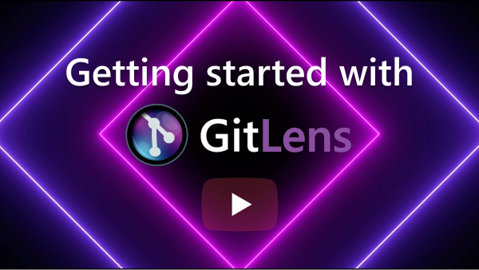

  

Git Extended **supercharges** Git inside VS Code and unlocks the <b>untapped knowledge</b> within each repository. Whether you’re a seasoned Git user or just getting started, Git Extended makes it easier, safer and faster to leverage the full power of Git. This tutorial will show you how to get the most out of Git Extended in VS Code.
