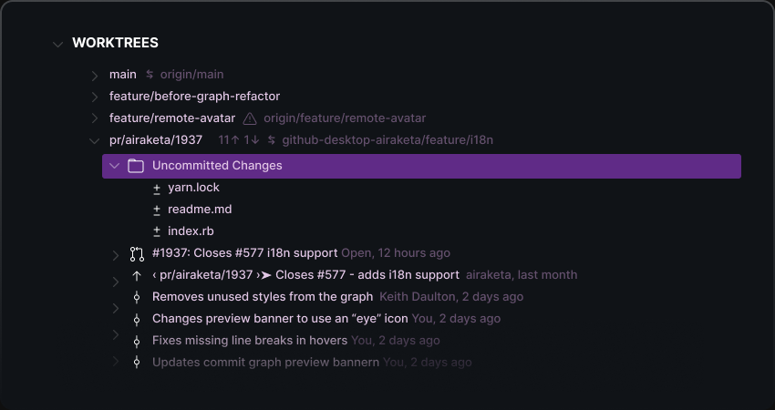

## Multitask with Worktrees

  

**Worktrees** help you multitask by minimizing context switching between branches, allowing you to easily work on different branches of a repository simultaneously.

Avoid interrupting your work in progress when needing to review a pull request or test a fix. Simply create a new worktree and open it in a new VS Code window, all without impacting your other work.

💡 Open the [Worktrees View](command:git-extended.showWorktreesView) or run [Create Worktree](command:git-extended.views.createWorktree) to get started.
