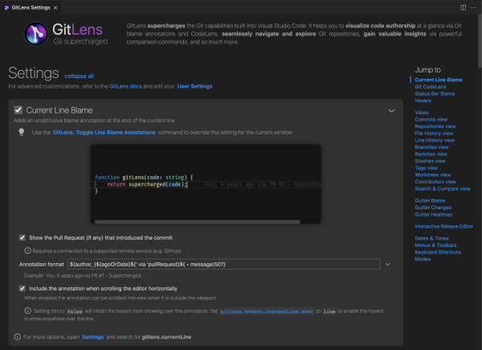

## Customize Git Extended

  

Git Extended provides a rich interactive settings editor, an easy-to-use interface, to configure many of Git Extended' powerful features.

💡 Use the [Git Extended: Open Settings](command:gitlens.showSettingsPage) command from the [Command Palette](command:workbench.action.quickOpen?%22>Git Extended%3A%20Open%20Settings%22) to open it.
