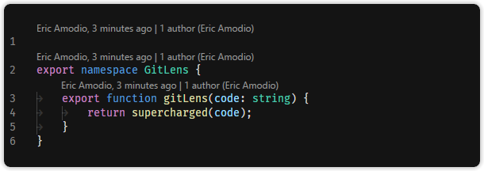

## Git CodeLens

  

Git Extended adds Git authorship CodeLens to the top of the file and on code blocks. The **recent change** CodeLens shows the author and date of the most recent commit for the code block or file, while the **authors** CodeLens shows the number of authors of the code block or file and the most prominent author (if there is more than one).

Clicking on the CodeLens performs a [customizable](command:gitlens.showSettingsPage?%22code-lens%22 'Jump to the Git CodeLens settings') action. For example, the **recent change** CodeLens will open a quick pick menu with the commit's file details and actions, where as the **authors** will toggle the whole file Git blame annotations.

💡 Use the [Toggle Git CodeLens](command:workbench.action.quickOpen?%22>Git Extended%3A%20Toggle%20Git%20CodeLens%22) command to turn the CodeLens on and off.

⚙️ Use the settings editor to customize the [Git CodeLens](command:gitlens.showSettingsPage?%22code-lens%22 'Jump to the Git CodeLens settings').
