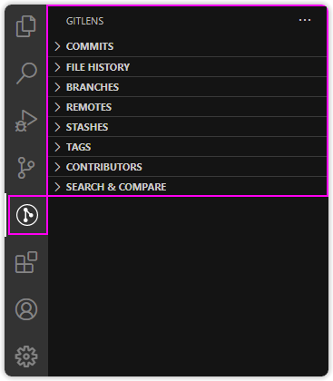
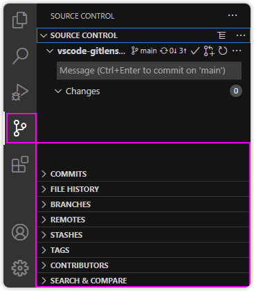

## Side Bar Views

  
  

Git Extended adds side bar views for Commits, File History, Branches, Remotes, Stashes, Tags, Contributors, Search & Compare, and more that provide rich source control details and functionality.

By default, these views can be displayed in either the [Git Extended side bar](command:gitlens.views.home.focus 'Open Git Extended side bar') or on the [Source Control side bar](command:workbench.scm.focus 'Open Source Control side bar').

💡 Use the [Git Extended: Set Views Layout](command:gitlens.setViewsLayout) command from the [Command Palette](command:workbench.action.quickOpen?%22>Git Extended%3A%20Set%20Views%20Layout%22) to change the layout, or drag & drop the views individually.
